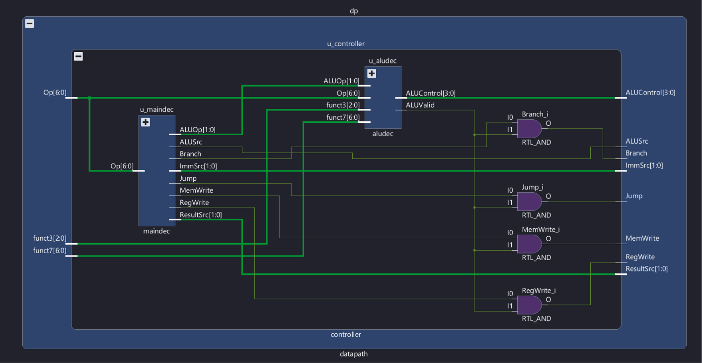
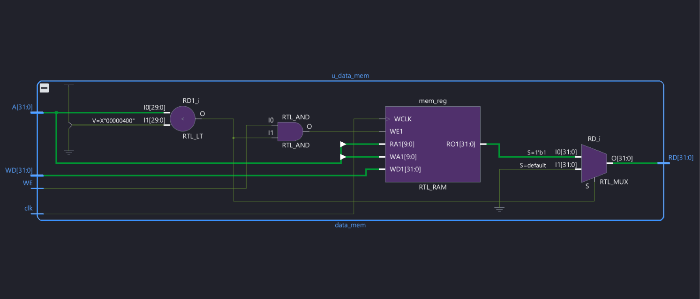
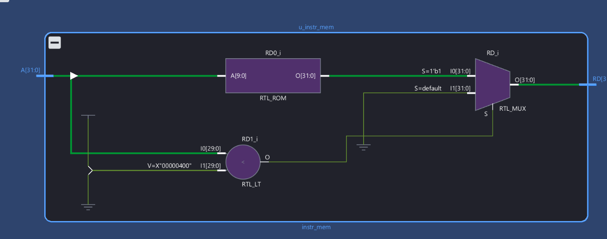
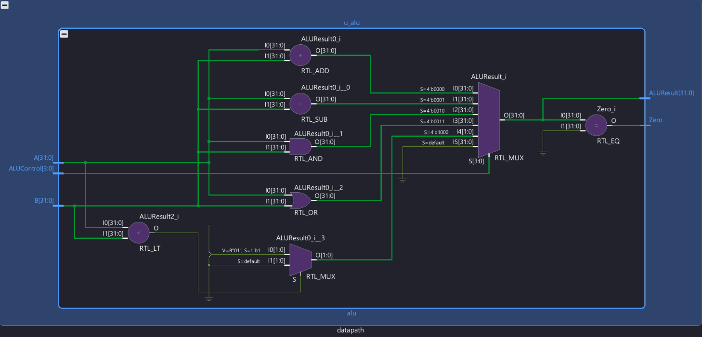
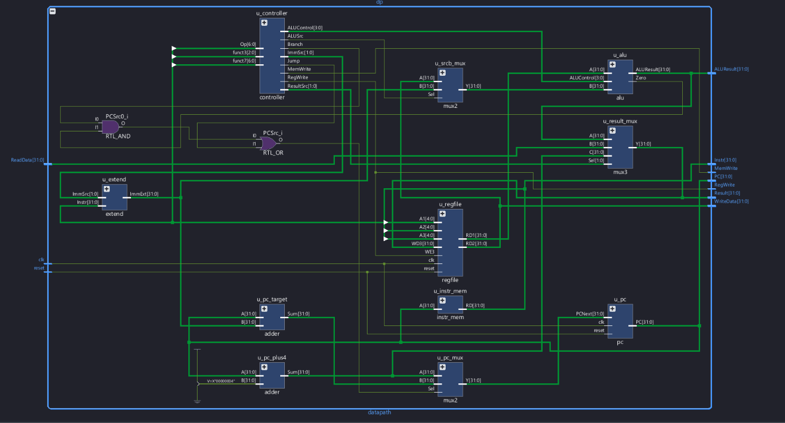
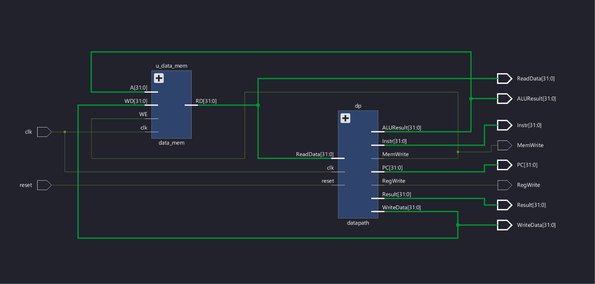
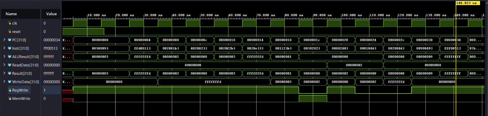
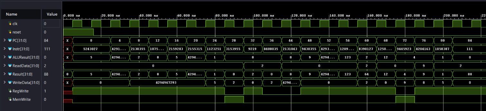

# Single-Cycle RV32I Processor

A single-cycle RV32I core with `riscv_single_top` as its top-level module.

## Files

```text
01_single_cycle/
├── README.md
├── doc/
│   ├── IMAGE_CAPTIONS.md
│   ├── Screenshot_2026-10-23_004535.png
│   ├── Screenshot_2026-10-23_004609.png
│   ├── Screenshot_2026-10-23_004633.png
│   ├── Screenshot_2026-10-23_004714.png
│   ├── Single_Cycle_Schematics_DP.png
│   ├── Single_Cycle_Schematics.png
│   ├── Single_Cycle_Simulation_hex.png
│   └── Single_Cycle_Simulation.png
├── docs/DEVELOPMENT_NOTES.md
├── mem/program.hex
├── rtl/
│   ├── adder.v
│   ├── alu.v
│   ├── aludec.v
│   ├── controller.v
│   ├── data_mem.v
│   ├── datapath.v
│   ├── extend.v
│   ├── instr_mem.v
│   ├── maindec.v
│   ├── mux2.v
│   ├── mux3.v
│   ├── pc.v
│   ├── regfile.v
│   └── riscv_single_top.v
└── tb/tb_single.v
```

## Modules

`riscv_single_top`, `datapath`, `controller`, `maindec`, `aludec`, `alu`, `extend`, `regfile`, `pc`, `adder`, `mux2`, `mux3`, `instr_mem`, and `data_mem`.

## Testbench

| Simulation top | Instruction image | Checks in the testbench |
|---|---|---|
| `tb_single` | `mem/program.hex` | x0–x14 and data-memory words 0–1. Expected register values are `0, 5, -3, 2, 8, 5, -3, 1, 2, 9, -1, 0x40, 12, 9, 1`; memory[0]=2 and memory[1]=9. |

## Before you simulate

Edit the absolute path in `rtl/instr_mem.v`, line 28. Current line:

```verilog
initial $readmemh("C:/Users/brije/Downloads/Vivado_projects/RISC_V_v1/program.hex", mem);
```

Change the string to the absolute path of this copy's `mem/program.hex`, using forward slashes. For this checkout, that file is under `C:/Users/brije/Downloads/Vivado_projects/RISC-V-Processors/01_single_cycle/mem/program.hex`.

## Run in Vivado

1. Create or open a Vivado project. Add all `.v` files in `rtl/` as Design Sources.
2. Add `tb/tb_single.v` as a Simulation Source and set `tb_single` as the simulation top.
3. Update the instruction-memory path above, then select **Run Behavioral Simulation** and **Run All**.

The testbench holds reset for two rising edges, runs 200 cycles, and prints one combined register-and-memory PASS/FAIL line. The original core was user-identified as verified with `tb_single`; a saved simulation transcript is not stated in this project.

## Images


*Figure 1: Vivado elaborated controller schematic showing the `maindec` and `aludec` blocks and their control-signal connections.*


*Figure 2: Vivado elaborated data-memory schematic showing address comparison, the memory register, write controls, and the read mux connected to `A`, `WD`, `WE`, `clk`, and `RD`.*


*Figure 3: Vivado elaborated instruction-memory schematic showing a ROM, address comparison, and output mux between the address input and instruction output.*


*Figure 4: Vivado elaborated ALU schematic showing add, subtract, AND, OR, less-than, result selection, and the `Zero` output.*


*Figure 5: Vivado elaborated schematic of the single-cycle datapath showing its controller, register file, PC and target logic, ALU, extender, and muxes.*


*Figure 6: Top-level block diagram connecting the controller/datapath to data memory and exposing the clock, reset, memory, PC, instruction, and result signals.*


*Figure 7: The 0–150 ns simulation waveform shows `PC`, hexadecimal `Instr`, `ALUResult`, `ReadData`, `Result`, `WriteData`, `RegWrite`, and `MemWrite`; the cursor is at 140.823 ns.*


*Figure 8: The 0–220 ns simulation waveform shows `PC`, `Instr`, `ALUResult`, `ReadData`, `Result`, `WriteData`, `RegWrite`, and `MemWrite` through the final displayed PC value of 84.*

