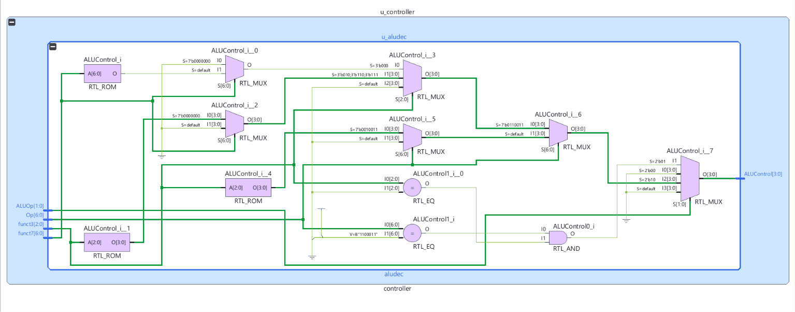
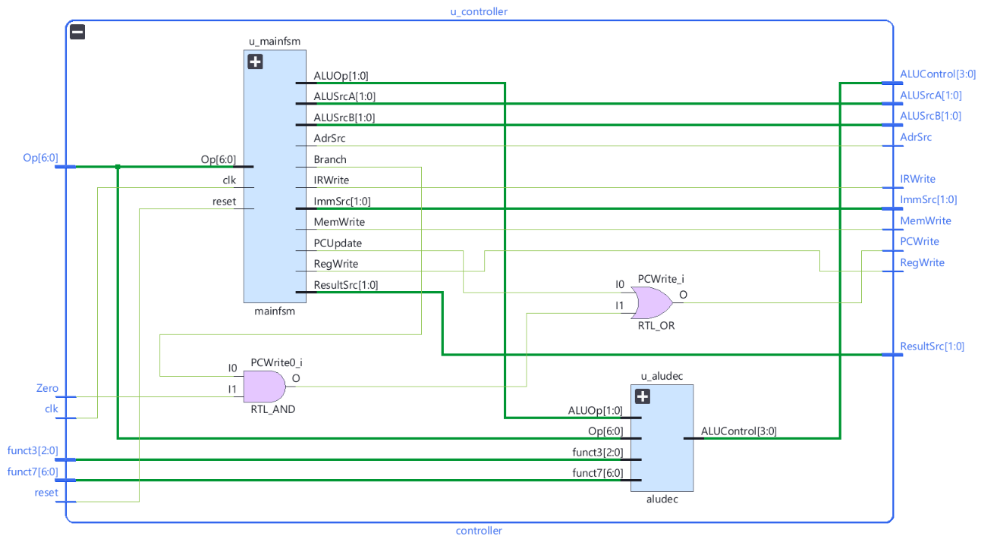
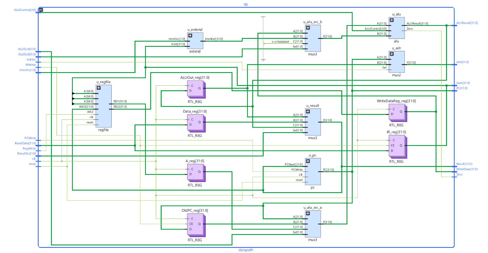
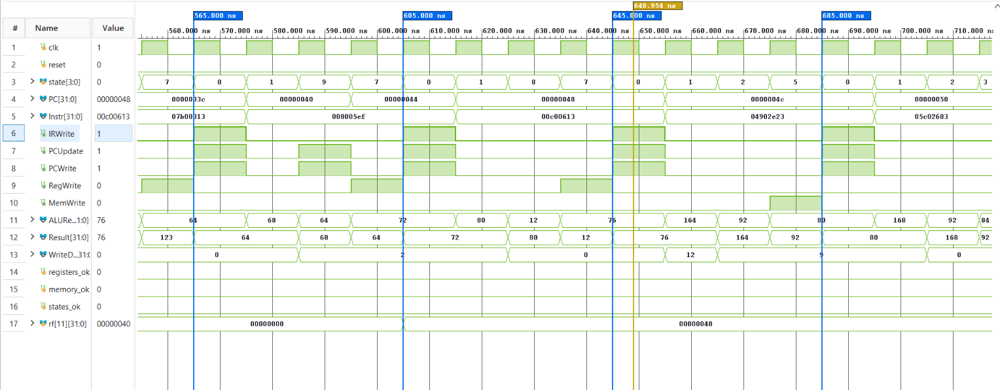
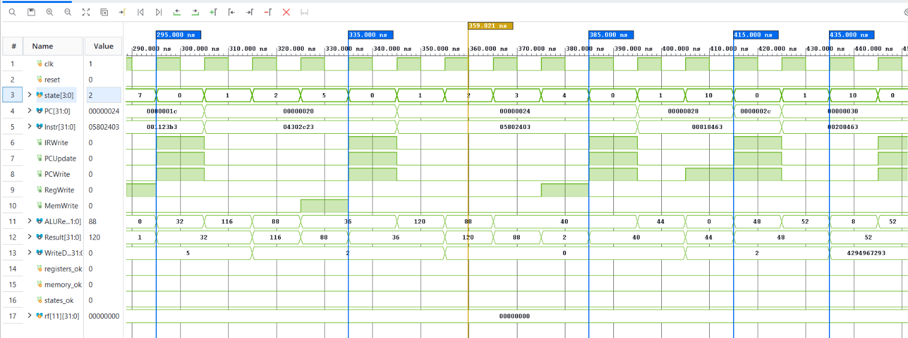
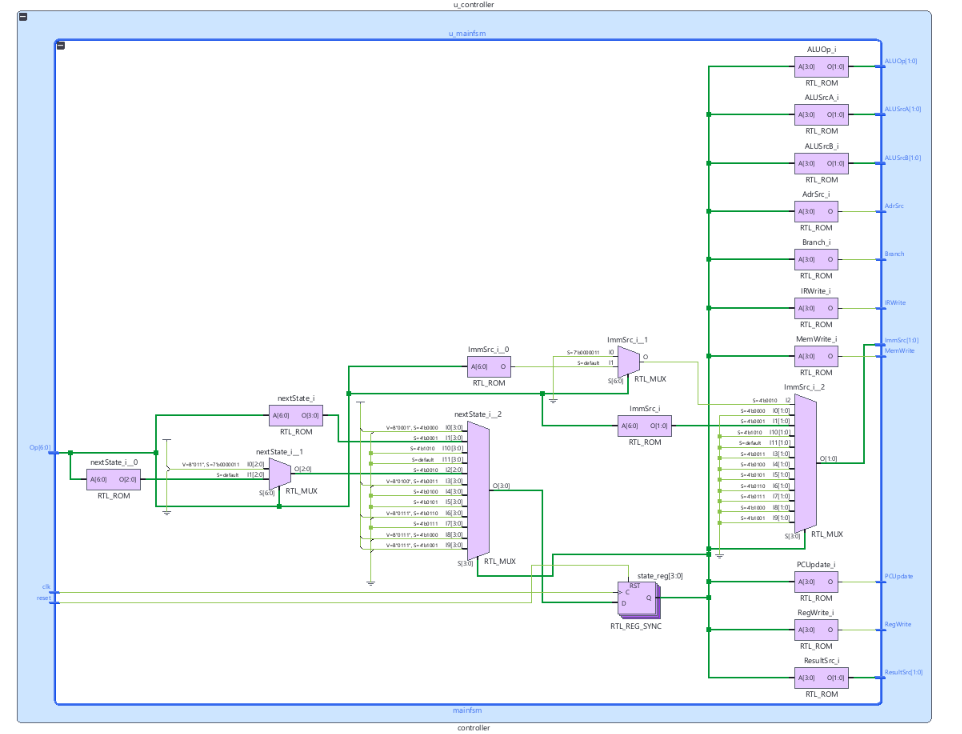
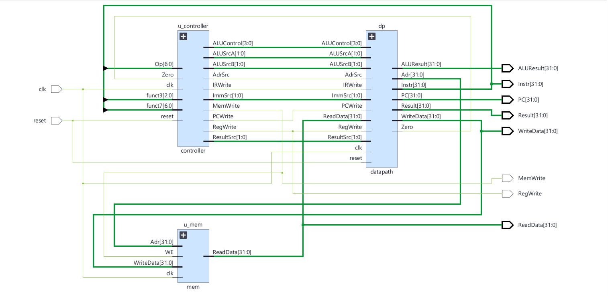
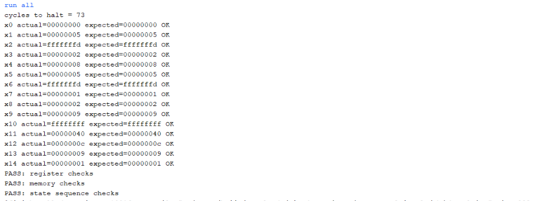
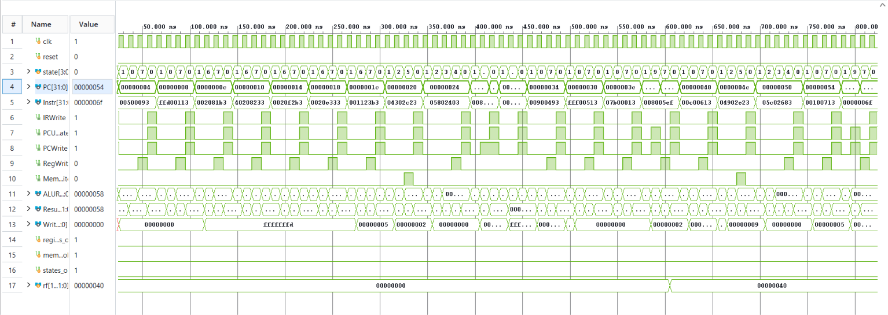

# Multicycle RV32I Processor

A multicycle RV32I processor using `riscv_multi_top`, a main finite-state machine, a shared datapath, and unified memory. The FSM state and control table is in [docs/SPEC_multicycle.md](docs/SPEC_multicycle.md).

## Files

```text
02_multicycle/
├── README.md
├── doc/
│   ├── IMAGE_CAPTIONS.md
│   └── img/             # Schematics, waveforms, and Tcl output
├── docs/
│   ├── DEVELOPMENT_NOTES.md
│   └── SPEC_multicycle.md
├── mem/program.hex
├── rtl/
│   ├── alu.v
│   ├── aludec.v
│   ├── controller.v
│   ├── datapath.v
│   ├── extend.v
│   ├── mainfsm.v
│   ├── mem.v
│   ├── mux2.v
│   ├── mux3.v
│   ├── pc.v
│   ├── regfile.v
│   └── riscv_multi_top.v
└── tb/tb_multi.v
```

## Modules

`riscv_multi_top`, `controller`, `mainfsm`, `datapath`, `alu`, `aludec`, `extend`, `regfile`, `pc`, `mem`, `mux2`, and `mux3`.

## Testbench

| Simulation top | Instruction image | Checks / expected result |
|---|---|---|
| `tb_multi` | `mem/program.hex` | Registers x0–x14 match the constants in the testbench; unified-memory words 22 and 23 are 2 and 9; state-sequence checks pass; the testbench reports 73 cycles to PC 84. |

## Before you simulate

The absolute image path is in `rtl/mem.v`, line 34:

```verilog
$readmemh("C:/Users/brije/Downloads/Vivado_projects/Multi_Cycle_RISC-V/program.hex", mem);
```

Change the string to the absolute path of this copy's `mem/program.hex`, using forward slashes. For this checkout, that file is under `C:/Users/brije/Downloads/Vivado_projects/RISC-V-Processors/02_multicycle/mem/program.hex`.

## Run in Vivado

1. Create or open a Vivado project. Add all `.v` files in `rtl/` as Design Sources.
2. Add `tb/tb_multi.v` as a Simulation Source and set `tb_multi` as the simulation top.
3. Update the memory image path above, then select **Run Behavioral Simulation** and **Run All**.

The included Tcl Console capture shows `cycles to halt = 73` and PASS for register, memory, and state-sequence checks.

## Images


*Figure 1: Vivado elaborated ALU-decoder schematic showing `ALUOp`, `Op`, `funct3`, and `funct7` inputs and the mux/ROM logic producing `ALUControl`.*


*Figure 2: Vivado elaborated controller schematic showing the main FSM, ALU decoder, `Zero` input, `PCWrite` logic, and the controller outputs.*


*Figure 3: Vivado elaborated multicycle datapath schematic showing the register file, datapath registers, ALU, extender, and address/source/result muxes.*


*Figure 4: The 560–710 ns waveform shows `state`, `PC`, `Instr`, `IRWrite`, `PCUpdate`, `PCWrite`, `RegWrite`, `MemWrite`, `ALUResult`, `Result`, and `rf[11]` around the visible instruction word `008005ef`.*


*Figure 5: The 290–450 ns waveform shows `state`, `PC`, `Instr`, `IRWrite`, `PCUpdate`, `PCWrite`, `RegWrite`, `MemWrite`, `ALUResult`, `Result`, and `WriteData` over the displayed load/store/branch interval.*


*Figure 6: Vivado elaborated RTL schematic of the main FSM, showing next-state and control-output logic; this is not a state-transition diagram, and the state/control table is in [docs/SPEC_multicycle.md](docs/SPEC_multicycle.md).*


*Figure 7: Top-level block diagram connecting the controller, datapath, and unified memory with their clock, reset, control, instruction, and data signals.*


*Figure 8: Tcl Console output of `tb_multi` showing cycles to halt = 73 and PASS for the register, memory, and state-sequence checks.*


*Figure 9: The waveform with ruler labels from 50 to 800 ns shows `state`, `PC`, `Instr`, `IRWrite`, `PCUpdate`, `PCWrite`, `RegWrite`, `MemWrite`, `ALUResult`, `Result`, and `WriteData`.*
