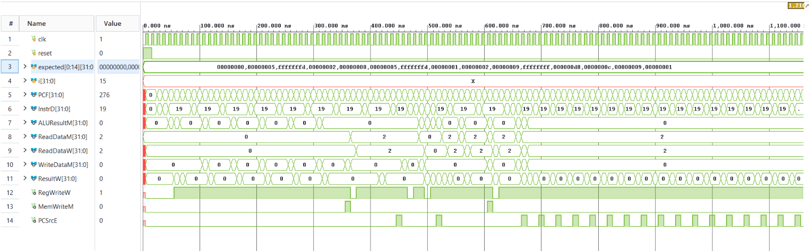
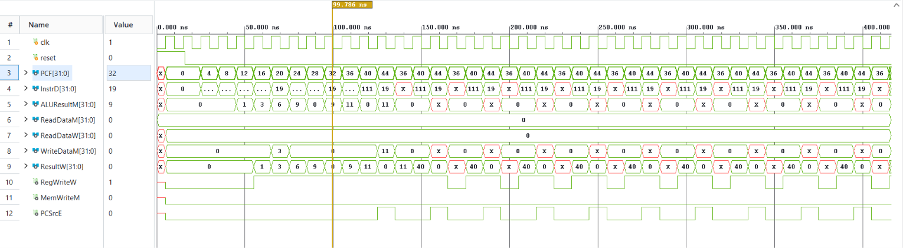
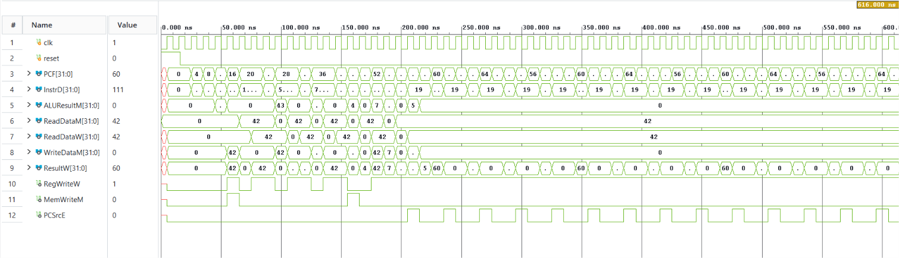
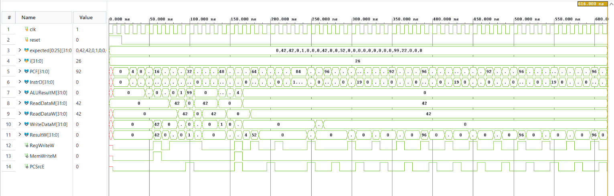
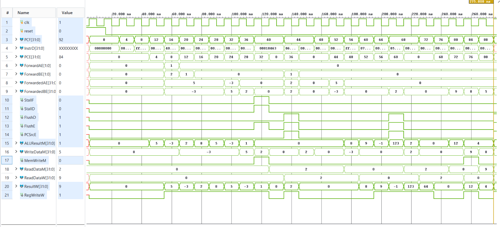
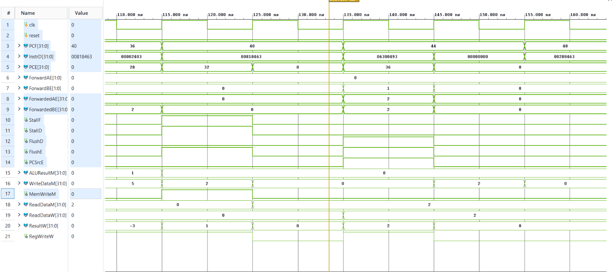
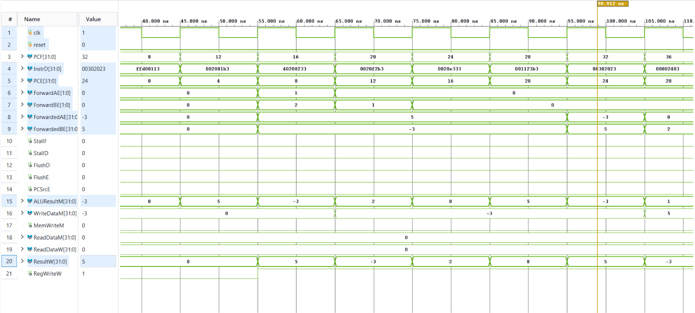
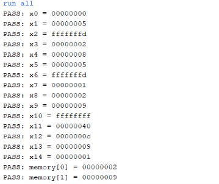

# Five-Stage RV32I Pipeline

A five-stage RV32I pipeline with Fetch, Decode, Execute, Memory, and Writeback stages. The project includes a datapath, pipeline registers, and a separate hazard unit.

## Architecture and hazard handling

Pipeline boundaries are F/D, D/E, E/M, and M/W; control signals travel with their instruction. `Rd` and `RegWrite` reach Writeback, `PCPlus4` is pipelined for JAL writeback, and forwarded store data reaches Memory. The register file writes on the falling edge and reads of x0 return zero.

Branch and JAL resolve in Execute (`PCSrcE`) with predict-not-taken. Forwarding feeds Execute, prioritizes Memory over Writeback, and never forwards x0. A load-use hazard stalls Fetch and Decode for one cycle and clears Execute. `FlushD = PCSrcE`; `FlushE = lwStall | PCSrcE`.

## Files

```text
03_pipelined/
├── README.md
├── doc/
│   ├── IMAGE_CAPTIONS.md
│   ├── program_padded.lst
│   └── img/
│       ├── 1_pipelined.png
│       ├── 2_forwarding.png
│       ├── 3_lw.png
│       ├── 4_flush.png
│       ├── 5_golden_overview1.png
│       ├── 5_golden_overview2_flush_stall.png
│       ├── 5_golden_overview3_forwarding.png
│       └── tcl.png
├── docs/DEVELOPMENT_NOTES.md
├── mem/
│   ├── program.hex
│   ├── program_golden.hex
│   ├── program_padded.hex
│   ├── test_flush.hex
│   ├── test_forwarding.hex
│   └── test_lwstall.hex
├── rtl/
│   ├── adder.v
│   ├── alu.v
│   ├── aludec.v
│   ├── controller.v
│   ├── data_mem.v
│   ├── datapath.v
│   ├── extend.v
│   ├── hazard_unit.v
│   ├── instr_mem.v
│   ├── maindec.v
│   ├── mux2.v
│   ├── mux3.v
│   ├── pc.v
│   ├── pipeline_reg.v
│   ├── regfile.v
│   └── riscv_pipeline_top.v
└── tb/
    ├── tb_flush.v
    ├── tb_forwarding.v
    ├── tb_golden.v
    ├── tb_lwstall.v
    └── tb_pipeline.v
```

## Modules

`riscv_pipeline_top`, `datapath`, `hazard_unit`, `pipeline_reg`, `pc`, `controller`, `maindec`, `aludec`, `alu`, `extend`, `regfile`, `adder`, `mux2`, `mux3`, `instr_mem`, and `data_mem`.

## Testbenches and expected results

Before each run, copy the indicated file to `mem/program.hex`. The expected values below are the checks defined by each testbench and the user-reported Vivado results.

| Simulation top | Image to copy to `mem/program.hex` | Expected result |
|---|---|---|
| `tb_forwarding` | `mem/test_forwarding.hex` | x0=0, x1=3, x2=6, x3=9, x4=9, x5=11, x6=11. |
| `tb_lwstall` | `mem/test_lwstall.hex` | x0=0; x1–x3=42; x4=43; x5–x8=42; x9=7; x10=49; x11=42; x12=5; memory[0]=42 and memory[1]=42. |
| `tb_flush` | `mem/test_flush.hex` | 31 checks: x1=42, x2=42, x4=1, x8=42, x11=0x34, x21=99, x22=22; other checked registers are zero; memory[0]=42, memory[1]=99, and memory[2–4]=0. |
| `tb_pipeline` | `mem/program_padded.hex` | 17 checks for x0–x14 and memory[0–1] match expected values; x11=0xD8. |
| `tb_golden` | `mem/program_golden.hex` | 17 checks match the single-cycle core for x0–x14 and memory[0–1]; x11=0x40, memory[0]=2, memory[1]=9. |

## Before you simulate

The absolute instruction-image path is in `rtl/instr_mem.v`, line 28:

```verilog
initial $readmemh("C:/Users/brije/Downloads/Vivado_projects/RISC_V_Pipeline_New/mem/program.hex", mem);
```

Change the string to the absolute path of this copy's `mem/program.hex`, using forward slashes. For this checkout, that file is under `C:/Users/brije/Downloads/Vivado_projects/RISC-V-Processors/03_pipelined/mem/program.hex`.

## Run in Vivado

1. Create or open a Vivado project. Add all `.v` files in `rtl/` as Design Sources.
2. Add the selected `tb/tb_*.v` as a Simulation Source and set that testbench module as the simulation top.
3. Copy the row's image to `mem/program.hex`. For example:

   ```powershell
   Copy-Item .\mem\test_forwarding.hex .\mem\program.hex -Force
   ```

4. Close any prior simulation, refresh the source hierarchy, select **Run Behavioral Simulation**, then **Run All**.

The user reports that all five testbenches passed in Vivado. The padded baseline produced x11=0xD8; the original unpadded program produced x11=0x40 and matched the single-cycle final state.

### Golden waveform note

In the original unpadded 22-instruction program, `InstrD` shows X values after about 265 ns as the final `jal x0` loop fetches words past the end of the program. Those wrong-path instructions are flushed and have no effect on architectural state; the zoomed waveform covers the program run.

## Images


*Figure 1: The `tb_pipeline` waveform for the NOP-padded program runs from 0 to 1216 ns and ends with the 17 x0–x14 and memory[0–1] checks, whose displayed values match the expected values.*


*Figure 2: The 0–400 ns `tb_forwarding` waveform, captured after forwarding was added and before flush logic, shows `PCF`, `InstrD`, `ALUResultM`, `ReadDataM`, `ReadDataW`, `WriteDataM`, `ResultW`, `RegWriteW`, `MemWriteM`, and `PCSrcE`; X values after about 150 ns come from the final `jal x0` loop fetching beyond the short test program and do not affect the checked registers.*


*Figure 3: The `tb_lwstall` run (about 0–616 ns) shows `PCF`, `InstrD`, `ALUResultM`, `ReadDataM`, `ReadDataW`, `WriteDataM`, `ResultW`, `RegWriteW`, `MemWriteM`, and `PCSrcE`.*


*Figure 4: The `tb_flush` run (about 0–616 ns) shows `PCF`, `InstrD`, `ALUResultM`, `ReadDataM`, `ReadDataW`, `WriteDataM`, `ResultW`, `RegWriteW`, `MemWriteM`, and `PCSrcE`.*


*Figure 5: The zoomed 20–275 ns `tb_golden` waveform covers the original unpadded 22-instruction program and shows `PCF`, `InstrD`, `PCE`, forwarding, stall/flush controls, and memory/writeback signals; X in `InstrD` after about 265 ns comes from the final `jal x0` loop fetching beyond the program, is flushed, and has no effect on state.*


*Figure 6: The 110–162 ns close-up of the original unpadded 22-instruction `tb_golden` run shows `PCF`, `InstrD`, `PCE`, `ForwardAE/BE`, `StallF/D`, `FlushD/E`, `PCSrcE`, and memory/writeback signals.*


*Figure 7: The 40–110 ns close-up of the original unpadded 22-instruction `tb_golden` run shows `PCF`, `InstrD`, `PCE`, `ForwardAE/BE`, `ForwardedAE/BE`, and the ALU/writeback signals.*


*Figure 8: Tcl Console output of `tb_golden` for the original program showing x11 = 0x40 and all 17 register and memory checks PASS.*
